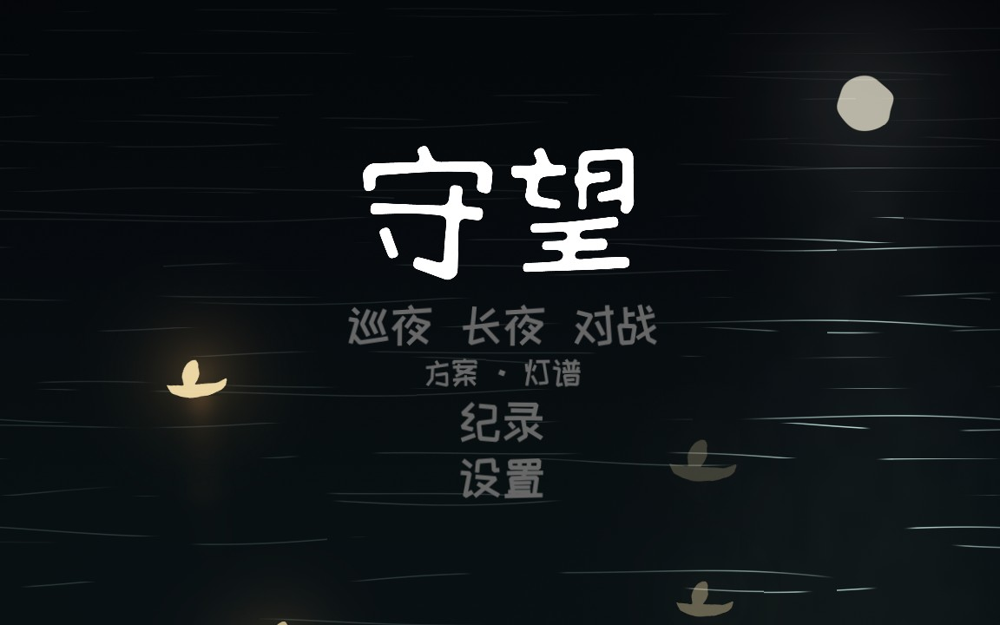

# 守望

江南水乡题材的回合制跳棋小品，Godot 4 工程。守塘的人夜里提灯出门，在河面上一格一格地跳，把河灯收齐，水车就开，走进去过关。




## 玩法

每局在一张浮在水面的棋盘上进行，河灯开局就摆好。从起点出发，沿着灯一盏一盏地收。

- 落在有灯的格子上不扣步数，连击 +1。连击越高，跳得越远。
- 踩到空格子扣一步，连击清零。主角头顶的数字是还能错几步。
- 收齐这一关的灯，水车就开。水车开了以后踩空格不再扣步，走进去过关。
- 有的沟只有靠道具才过得了，看准了再跳。
- 收灯给技能充能，充满了可以放一次技能。
- 一关没过可以原地再来，灯还是原来那一局（中等和简单下）。
- 玩法分四档难度，每上一档多几条规矩：手里的灯、步数带过关、风向、夜巡。见下面「难度四档」。

格子有四种：普通格；脆格，离开后碎掉，过一会儿长回来；障碍，落不上去；补给格，踩上去不扣步数反而加两步，每格每关只能用一次。

每关摆好的这一局是生成出来的，生成的时候就保证有一条一步不错就能收齐的路线。能不能过看会不会找路，不看运气。

### 道具

每关路线上摆着几件道具，跳上去捡。九种道具各管一件事：

| 道具 | 图标 | 捡到之后 |
|---|---|---|
| 莲蓬 | `combooo-1.png` 到 `combooo-6.png` | 连击 +3 |
| 纸伞 | `upgrade-umbrella.png` | 下一跳跳得特别远 |
| 草鞋 | `upgrade-shoe.png` | 这一关每一跳都更远 |
| 斗笠 | `hat.png` | 挡一次踩空（不扣步，连击也不断） |
| 钓竿 | `upgrade-cane.png` | 收走最远的两盏灯 |
| 捞网 | `upgrade-magnet.png` | 河灯都向你挪两格 |
| 水车 | `portal.png` | 卷走身边两格内的灯 |
| 食盒 | `chest.png` | 步数 +3 |
| 铜钱 | `clover.png` | 身边买来两件道具 |

图标都在 `assets/sprites/upgrades/`。另有蒸笼（`heart.png`，步数 +1），只在步数没带满进关的档（困难、非常困难）里出现。

### 两种模式

巡夜是主线，12 关，三章各四关，每章一种主色：水乡生活是石绿，家族传承是赭石，节庆巡游是朱砂。第一章学会连击跳，第二章开始有道具和沟，第三章棋盘大、路线长。巡夜里每一关是固定的一局，练的就是它。

长夜是无尽模式，棋盘和灯每次现摆，越往后越大、路线越长。步数从上一更带过去，每更补一步。

### 对战

标题页最上面一行的「对战」里有五种，都是跟一个对手（或者跟时间）争胜负。棋盘、跳格子、连击、道具都和平时一样，只是多了一个对手，输赢的规矩各不相同。选一种，再选同伴，就开局。

| 玩法 | 跟谁斗 | 怎么分胜负 |
|---|---|---|
| 抢灯 | 对手（朱砂色） | 一张棋盘上两个人同时跳，灯谁先踩到归谁，踩到的灯染上自己的颜色。不花步数，收得越多跳得越远。灯抢完或一分钟到，灯多的人赢 |
| 追影 | 影子 | 平时的规则，身后有个影子沿着一条一步不错的路线匀速走。它甩开你三盏灯（它走过的步数比你收的灯多三）你就输了；你先进水车就赢 |
| 夺岸 | 熄灯人 | 不摆灯。你踩过的格子上点起一盏灯，对手走到哪儿就把身边一圈的灯吹灭。限时之内让七成格子同时亮着就赢 |
| 轮战 | 一炷香 | 平时的规则，香一共 45 秒，连着过棋盘，过一张香接长 15 秒。香烧完为止，过的棋盘越多分越高 |
| 对弈 | 对手 | 一张棋盘轮流跳，一次一跳，踩到的灯归自己、留在原地上色，谁也不能再落在那格。踩了空格，对手就连跳一次。灯分完，灯多的人赢 |

对手的脑子就是自动试玩的那个「随手玩」机器人（`BoardSim` 的贪心打法：够得着的灯里挑最近的），所以它是下限，多想一步就赢得过它。现在两个机器人对打：抢灯 6 比 5，对弈 7 比 3（先手很占便宜），追影、夺岸、轮战都赢得了。平衡还没有细调。

### 对战的数（参数）

每套玩法的数都在 `resources/versus/<玩法>.tres` 里，改它就行，不用动代码（文件不在就用 `versus_rules.gd` 里给的默认值）：

| 参数 | 是什么 | 默认 |
|---|---|---|
| `board_index` | 用巡夜第几张棋盘（从 0 数，0 是"石步"） | 抢灯 5、追影 3、夺岸 6、轮战 0、对弈 7 |
| `lamps` | 摆几盏灯 | 11 / 6 / — / 5 / 10 |
| `time_limit` | 一局限时几秒（0 = 不限时） | 60 / 0 / 60 / 45 / 0 |
| `bonus_time` | 轮战：过一张棋盘香接几秒 | 15 |
| `foe_pace` | 对手几秒走一步（对弈里是"想几秒"） | 1.05 / 1.5 / 2.4 / — / 0.7 |
| `lead_lose` | 追影：被甩开几盏就输 | 3 |
| `share_goal` | 夺岸：要让几成格子同时亮着 | 0.7 |
| `foe_reach` | 夺岸：熄灯人一步够多远（格） | 1.7 |
| `foe_edge` | 对弈：对手的跳跃按多收了几盏算（平衡用） | 2 |
| `items`、`gap`、`detour` | 摆棋：几件道具、多贴极限、多绕路 | 各玩法不同 |

例：把 `resources/versus/territory.tres` 的 `share_goal` 从 0.70 改成 0.50，目标就从"21 格亮 15 盏"变成"亮 11 盏"（验过）。

代码在 `scripts/versus/`：`versus_base.gd` 是共用的（对手这个角色、头顶那一行战况、计时、结算的说法、找路），其余五个各管自己的规则。`main.gd` 只在几个关键的地方问一句这个玩法（用哪张棋盘、要不要摆灯、主角落地谁来处理、哪些格子能跳、进水车以后怎样）；平时那两种模式不带它，玩法一点没变。标题页的选择面板是 `scripts/uis/versus_picker.gd`。

### 六位角色

| 角色 | 技能 | 怎么解锁 |
|---|---|---|
| 守夜人 | 点灯，两盏新的河灯落在身边 | 一开始就有 |
| 钓叟 | 甩竿，收走最远的两盏河灯 | 打到第 5 关 |
| 船家少年 | 一篙撑到底，这一步想跳多远都行 | 连击到 10 |
| 渔娘 | 撒网，把河灯都揽过来 | 一步未错地过一关 |
| 货郎 | 打开货担，身边落下一件道具 | 得分到 1000 |
| 小鼓手 | 敲一阵鼓，变出一枚莲蓬 | 一步未错、连击到 10 地过一关 |

小鼓手的连击上限更高，鼓点密了步子反而短。

## 难度四档

选了的记在存档里。三个地方都能换，玩到一半想换不用退回标题页：

- **标题页**：「难度 · 中等」按钮，点开是选择页，每一档多了什么规矩都写在上面。
- **玩到一半**：暂停菜单（Esc）第二行「难度 ‹ 中等 ›」，点一下箭头换一档。这一关马上按新难度从头来，前面几关的进度不丢。
- **没过的时侯**：结算面板上有一行「‹ 困难 ›」。点 ‹ 调低一档，马上重来这一关；点 › 调高一档。

半路调过难度的那一局，成绩记在用过的最低一档名下。

难度不是把数一个一个收紧，而是**每上一档多几条规矩**。每条规矩是一个开关，后面跟着它自己的数，全在 `resources/rulesets/` 下的 `.tres` 里：想调，改数就行，不用动代码。

| 难度 | 比上一档多了什么 | 适合 |
|---|---|---|
| 简单 | 步数宽三步，每一跳多跳 0.7 格，补给格多两个，手里有四盏灯 | 只想看画面 |
| 中等（默认） | 步数刚够，手里有两盏灯 | 大多数人 |
| 困难 | 步数少一步、从第一关带到最后一关（每关补一步，最多补到上限）；每关最多重来 3 次；有风向；沟多一道；手里只剩一盏灯 | 熟手 |
| 非常困难 | 不能重来；水车开了以后走回去还要花步数；夜巡；补给格少一个、道具少一件；手里没有灯 | 一步都不能错 |

几条规矩：

- **跳得远**（简单）：每一跳多跳 0.7 格。连击 2 就跳得过一道两格宽的墙，随手玩也不容易被困在半边棋盘上。
- **手里的灯**（简单、中等、困难）：开局手里有几盏自己的灯（简单四盏、中等两盏、困难一盏）。鼠标（手柄是光标）指着够得着的空格，按 E（手柄 X）放一盏，花一步。放上去的灯踩到算有灯、算收了一盏，可不给分、不加连击。踩了空、接不上的时候用它补一步。
- **步数带过关**（困难、非常困难）：过关以后步数不清零，带着走，每过一关补一步。步数没带满进关时棋盘上多一个蒸笼。
- **风向**（困难、非常困难）：每一关有风，左上角的旗子飘向哪边，风就往哪边吹。顺风跳得远、逆风跳得近（逆风再少也还能跳一格）。巡夜里每一关刮什么风是定的，连着两关不刮同一种风。
- **夜巡**（非常困难）：左上角有一支蜡烛在烧。蜡烧完，离你最远的那盏河灯就灭，灯少了就收不齐，这一关就守不住了。每跳一下蜡长回一点。一支蜡 30 秒，也是开头看棋盘的时间；之后每一步想得比 3 秒久，蜡就净短一截。
- **重来**：简单、中等没过可以原地再来（灯还是那一局）；困难每关最多 3 次；非常困难一关没过从头来。
- **水车开了走回去**：简单到困难，水车开了以后踩空格不扣步；非常困难要花步数，最后一盏灯得留着从水车边上收。

选择页上列的是当前这一档的规矩，都是读 `.tres` 自动生成的。玩法卡片和开局的那几条提示也跟着档变。

### 自己调

四个文件 `resources/rulesets/1_easy.tres` 到 `4_extreme.tres`，在 Godot 的检查器里打开，每条规矩一个分组。所有能调的数都在 `scripts/ruleset.gd` 里，带说明。常用的几个：

| 想改什么 | 改哪个数 |
|---|---|
| 步数宽紧 | `moves_add`；带过关的档还有 `moves_bonus`（每关补几步）、`moves_cap_add`（最多比上限多几步） |
| 跳得多远 | `reach_add`（每一跳多跳几格）。想让一档好过，加它，别减道具：道具和沟少了，长夜的随机棋盘反而容易摆不出保证有解的局 |
| 难不难找路 | `lamp_gate_add`（带沟的道具加减几件）、`lamp_items_add`（道具加减几件）。这两个对难易最管用 |
| 手里的灯 | `hold_lamps`（几盏）、`hold_cost`（放一盏花几步）、`hold_per_coin`（捡到铜钱多几盏） |
| 风 | `wind_bonus`（顺风多跳多远）、`wind_penalty`（逆风少跳多远）、`wind_floor`（逆风最少还能跳多远） |
| 夜巡的松紧 | `night_seconds`（一支蜡烧多久，也是开头看棋盘的时间）、`night_gain`（每跳一下长回几秒）、`night_every` |
| 补给格 | `spring_add` |

想再加一档：复制一份 `.tres`、改 `id` 和 `title`，文件名开头的数字是它在选择页里排第几。档数不限，测试里核对"由易到难"的地方按 `tier` 来。

### 过关率是量出来的

每一档的数不是拍脑袋定的。让"随手玩"的机器人（`BoardSim`：够得着的灯里挑最近的，不会找路）把每一档从头打 N 局，看它的过关率。它和游戏里摆棋、走棋用的是同一套代码（`BoardGen.ruleset_opt`、`BoardSim`），所以量和玩是同一种局。这是下限，真人多想一步就比它强。

```bash
tools/playtest/agent.sh a7 rates 200                 # 四档各打 200 局，报每一关的过关率、整局打通的比例
tools/playtest/agent.sh a7 rates 200 > builds/rates.txt && python3 tools/playtest/rates_report.py builds/rates.txt
                                                     # 量完把表换进 tools/playtest/rates.md（手写的说明不动）
tools/playtest/agent.sh a7 rates 100 3 hard          # 只打困难，设机器人每走一步想 3 秒（只对夜巡有用）
tools/playtest/agent.sh a7 rates 100 1 easy 'set=moves_add=3 set=hold_lamps=5'   # 临时改几个数再量，不写进 .tres
```

现在这一版的数见 `tools/playtest/rates.md`。`rates` 每回都核对，不对就报没过：四档由易到难（整局打通的比例一档比一档低）；简单档八成以上打穿；每一档长夜前 12 更"摆不出来"的局不超过 2%。

## 开场动画

游戏一启动播一段三四秒的开场，按任意键或手柄按键跳过。默认每次开机随机换一个，不会连着两次一样；「设置」里的「开场」可以固定成某一个，或者选「不播」。三个方案：

| 方案 | 是什么 |
|---|---|
| 一灯破夜 | 一片黑里一点灯花，一盏河灯漂上来，一串灯从水底涌起，汇到标志处炸开成光 |
| 水墨惊雷 | 宣纸上一滴墨化开，标志从墨里反白浮现，一方朱红大印盖下来，墨色铺满全屏转场 |
| 守夜人点灯 | 五块石台升起，守夜人一格一格跳过去，每落一格点亮一盏灯，最后一举灯照亮全屏 |

代码在 `scripts/uis/opening.gd`，着色器是 `shaders/opening_*.gdshader`，全是实时演的，没有视频文件。

每一段都配着一段声音，一下一下对着画面：灯花是火苗窜起来，涟漪是水珠落进水里，大印盖下来是一声堂鼓，守夜人每落一步是湿石台上的一声。开场播着的时候，标题页自己的音乐压低 13 分贝；揭出标题时音乐回来。开场自己的声音按音效的音量走。

乐器是古筝和琵琶，音都从标题音乐的调里来：升 C 宫五声（升 C、E、升 F、升 G、B）。三段各用一种招牌技法，一听就分得出：

| 方案 | 技法 | 画面上是什么 |
|---|---|---|
| A 一灯破夜 | 古筝**刮奏**（手指扫过一串弦，音一路往上） | 一串河灯从水底涌起来，正好是刮奏在往上走 |
| B 水墨惊雷 | 琵琶**扫弦**、古筝**按音**、印章用**堂鼓** | 墨落在纸上、大印盖下去；标志从墨里浮出来是古筝把弦按上去、音往上滑 |
| D 守夜人点灯 | 古筝**五声一步一个音往上走**，最后**摇指** | 守夜人一格一格跳过去，每落一步是一个音；举灯那一下摇指 |

三段是一套的：

- 底都是夜里的河面；水、木头、石头、纸、火这几样只是拟音，不是乐器；三段共用同一个混响空间。
- 最后都落在升 C 上，紧接着标题音乐从它的第一个和弦进来。
- 噪声类的拟音基本保持干声，像贴着录的；空间感留给弦乐。

录一段真正的开机画面来看（帧取回到 `builds/opening/<方案>/`）。录制脚本会核对游戏实际播的是不是要录的那个、声音放出来没有，不对就报错：

```bash
tools/playtest/agent.sh a7 opening B 5 20   # 录 5 秒、每秒 20 张（30 也行；再高这台机器存不过来，
                                            # 存少了按名义帧率回放，画面会比声音快——录制脚本会报出来）
tools/playtest/assemble_opening.sh          # 本机要有 ffmpeg：每个方案拼成带声音的 open<A>.mp4 和没声音的 open<A>.gif，
                                            # 三个都有的时候再拼三宫格的对照图 openALL（没声音）和三段连着放的 openABD.mp4（带声音）
```

查开场在游戏里的样子（在播、声音放出来了、音乐压低了；播完了音乐回来）：

```bash
SW_BOOT_WAIT=1 SW_OPENING=D tools/playtest/agent.sh a7 drive tools/playtest/steps_opening.txt opening
```

`SW_BOOT_WAIT=1` 是让脚本游戏一起来就动手（平时先等 6 秒，开场早播完了）；`SW_OPENING` 指定播哪一个，不给就按设置里的来。导出以后把 `drive` 换成 `smoke` 查导出包。

### 改声音

开场的声音不是录的，是用脚本算出来的，和贴图一个做法，每次算出来一模一样。改了动画里动作的时刻（`opening.gd`），声音要跟着改：

```bash
python3 tools/audio/opening.py            # 重算三段，写 assets/audio/opening/open<A>.wav，报每段的响度
python3 tools/audio/opening.py B --check  # 只算 B，另外在 builds/audio/ 里画一张频谱和波形图
python3 tools/audio/look.py 某段音频.wav   # 把任何一段声音画成图看
```

只用 numpy。三个文件各管一件事：

| 文件 | 放的是什么 |
|---|---|
| `tools/audio/synth.py` | 工具：噪声、包络、滤波、混响、写 WAV |
| `tools/audio/instruments_cn.py` | 古筝、琵琶，以及刮奏、摇指、轮指、扫弦、按音、推拉弦这些技法 |
| `tools/audio/instruments.py` | 拟音：水珠、水花、木块、石台脚步、水车吱呀、纸笔、灯火、闷雷、夜里的河面 |
| `tools/audio/opening.py` | 什么东西在哪一刻响、在哪边、多响。每一段对着动画的时间点，写在函数里 |

古筝和琵琶是照着弦振动的道理算的，不是采样；印章那一声是堂鼓（皮膜振动不成整倍数，打下去音高先高后落）：一根弦响的是它的整倍数泛音（真实弦越高的泛音偏得越多），拨在弦长的哪个位置决定哪些泛音响，越高的泛音灭得越快；木头琴身又有几个固定共鸣。两样乐器在这些地方不一样，所以听起来也不一样：

这些脚本我自己听不见，是看着频谱图和响度数字调出来的。哪一下不对，改了重算就行。

| 差别 | 古筝 | 琵琶 |
|---|---|---|
| 弦 | 丝缠钢丝弦，二十一根 | 四根，品上按 |
| 起手 | 软一点，指甲碰弦 | 义甲碰弦，一下很硬的亮声 |
| 余音 | 长，会唱（吟揉是音高的细颤） | 短，更脆 |
| 技法 | 刮奏、摇指、按音 | 轮指、扫弦、推拉弦 |

### 旁白（可选）

三句台词在 `tools/audio/voice.py` 的开头，是一套的。旁白得是人的声音，不由脚本生成：要么自己录，要么请人录。

```bash
tools/audio/record_voice.sh A       # 在本机录 A 那一句（要用麦克风），存到 builds/voice/
python3 tools/audio/voice.py A      # 收拾干净（去底噪、掐空白、对响度），放进 assets/audio/opening/voiceA.wav
```

放进去以后不用改任何东西：开场播到第 0.3 秒时这句放出来，开场自己的声音轻一截，说完回来。没有这个文件就不放。

## 背景：一条夜里的河

标题页和游戏里是同一条河，全是实时算的，没有背景图：暗底、几道细细的水纹（弯弯曲曲、断断续续，从远处往近处流）、暖色的河灯。河灯用的是 `assets/sprites/upgrades/fish.png` 那张涂鸦（开场「一灯破夜」里飞进标志的也是它），底下一团暖光、一道倒影，火苗会晃。

### 标题页

`scripts/uis/lobby_river.gd`，水面在 `shaders/lobby_river.gdshader` 里算。右上角是水里的月影，底下一道月光，水纹走进月光里会亮起来。

| 动一下 | 河面的反应 |
|---|---|
| 鼠标、手指划过水面 | 划过的地方起涟漪，附近的水纹亮一点，像提着灯照着 |
| 菜单的焦点挪到哪个按钮 | 那个按钮底下荡开一圈；点一下是一圈大的 |
| 开场动画收完 | 从标志底下荡开一圈，像那盏灯刚落回河里 |
| 一直没人动 | 河上的灯每 8 秒多一盏，最多 14 盏；一动就回到 6 盏上下 |

河灯漂到标志和菜单后面会让开（看不见），过去了再亮回来。

### 游戏里的布局

`scripts/stage_backdrop.gd` 挂在 `scenes/main.tscn` 里、界面那一层的前面，只读游戏里的水面、主角、棋盘和镜头，玩法不依赖它。水面是 `shaders/stage_water.gdshader`：真三维的水面，水纹画在世界上，远近的透视自己对。远岸的天空是 `shaders/stage_sky.gdshader`。三种布局共用这一套，只是光从哪来、装饰放在哪不一样：

| 布局 | 画面 |
|---|---|
| 1 长河 | 整个画面都是水；月影钉在左侧的空处，月光贴着那一侧往近处流 |
| 2 远岸 | 水到远处就到头了，顶上让出一条天空：一轮月亮、三层远山、山脚下的雾 |
| 3 月下 | 棋盘底下一汪月光；水纹在那一汪里让开，边上才亮 |

主角落到哪个格子，哪个格子底下就荡开一圈：水面上那一圈（落在棋盘中间时会被四周的格子挡住），加上格子面上的一圈淡环（画在最上层，站在哪儿都看得见）。

河的底色还是跟着章节和连击走：`colors.gd` 每一帧按 `water_color`、`light_foam_color`、`dark_foam_color` 这三个参数改它，参数名没换；只是往墨色里压了一截，是夜里的河。

平时用的是**月下**。另外两种（和原来那块铺满网纹的水）都留着，用环境变量 `SW_STAGE` 临时换着看（录预览、对比的时候用）：

```bash
SW_STAGE=2 tools/playtest/agent.sh a7 drive tools/playtest/steps_stage.txt 远岸   # 1 长河、2 远岸、3 月下、0 原来的网纹；进第 1、8、12 关各截一张，再量帧时间
tools/playtest/agent.sh a7 stage 2                                               # 录一段进游戏、在棋盘上跳几下的
tools/playtest/assemble_stage.sh 2                                               # 拼成 builds/stage/stage2.mp4
tools/playtest/assemble_stage_all.sh                                             # 三种都录过以后，拼一段三个并排的
```

标题页那条河：

```bash
tools/playtest/agent.sh a7 lobby                                                     # 录 20 秒：没人动 → 指针划过 → 挪菜单焦点
tools/playtest/assemble_lobby.sh                                                     # 拼成 builds/lobby/lobby.mp4，带标题音乐
SW_OPENING=off tools/playtest/agent.sh a7 drive tools/playtest/steps_lobby.txt lobby   # 截图、量帧时间
```

`SW_OPENING=off` 是临时当成设置里选了「不播」。这时开机的黑幕要撤掉、标题页看得见，用 `steps_no_opening.txt` 查（以前只有开场动画才撤这块黑幕，选「不播」的话整个画面是黑的）。

河灯这一份两边共用：`scripts/uis/river_lamps.gd`。

对战：

```bash
tools/playtest/agent.sh a7 versus 2                                                   # 录一局追影
tools/playtest/assemble_versus.sh 2                                                   # 拼成 builds/versus/对战2.mp4，带游戏里的音乐
SW_OPENING=off tools/playtest/agent.sh a7 drive tools/playtest/steps_versus.txt versus   # 标题页的"对战"入口和选择面板
SW_OPENING=off SW_BOOT_WAIT=2 tools/playtest/agent.sh a7 drive tools/playtest/steps_versus_play.txt vplay   # 五种玩法各打一局（主角交给机器人），
                                                                                             # 顺便查对战的局没套标题页上选的难度
tools/playtest/agent.sh a7 drive tools/playtest/steps_restart.txt restart            # 对战里按"重来"：重开一局新的
tools/playtest/agent.sh a7 drive tools/playtest/steps_aim.txt aim                    # 要在棋盘上选目标的技能（守夜人点灯；钓叟收灯是 steps_aim2.txt）
```

对战用自己的数（`resources/versus/`），不套标题页上选的难度：对战的局里步数的加减、风向、夜巡、手里的灯都不算数，暂停菜单和结算面板上也不放难度的加减器。`all` 里跑 `steps_versus_play.txt` 的那一步故意带着 `SW_RULESET=extreme`，查的就是这个。

## 换关的过渡

过关换关、长夜的下一更、重来、换难度、轮战换棋盘，还有标题页和游戏之间换场景，都先把画面盖住、再掀开。
平时固定用**墨迹晕开**（`ink`，`scripts/uis/scene_transition_control.gd` 的 `DEFAULT`）。另外还做了四种，都在仓库里、平时不出现：
河灯涌来（`lanterns`）、石阶沉浮（`steps`）、镜头钻进水车（`wheel`）、涟漪开合（`ripple`），以及原来那一套石砖墙
（`tiles`，一层石砖贴图的着色器淡入淡出，各 0.5 秒）。想让它们每一趟随机出现，把 `SW_TRANSITION` 设成 `random`
（池是 `RANDOM_POOL`：河灯、石阶、水车、墨迹；不连着两趟一样）。
别的样式在 `scripts/uis/transitions/` 里，每种一个文件。接口、怎么加一种、怎么量怎么录，都在 [`docs/transitions.md`](docs/transitions.md)。

```bash
tools/playtest/agent.sh a7 transition ripple                             # 录一段（第 1 关踩上水车到进第 2 关），帧回到 builds/transition/ripple/
tools/playtest/assemble_transition.sh ripple                              # 拼 ripple.mp4、ripple_slow.mp4（放慢 2.5 倍）、ripple_sheet.jpg（拼图）
tools/playtest/assemble_transition.sh compare tiles ripple lanterns       # 几种并排、对齐到过渡开始的那一帧：builds/transition/compare.mp4
tools/playtest/agent.sh a7 drive tools/playtest/steps_transition.txt trans_ink          # 平时那一种，量两趟：盖住、掀开各多久、最长的一帧多长
SW_TRANSITION=lanterns tools/playtest/agent.sh a7 drive tools/playtest/steps_transition.txt trans_lanterns   # 换一种量
SW_TRANSITION=random tools/playtest/agent.sh a7 drive tools/playtest/steps_transition_random.txt trans_random   # 随机：连换十次关，看抽到哪些、每一趟的数
```

`SW_TRANSITION` 临时换成别的一种（写 `random` 是随机），不写存档；不写就是墨迹晕开。`all` 的最后会把有的每一种都量一遍，再量一遍随机。
开机的时候要用的样式在黑幕底下建好、预热好（随机的话一池都建好），换关途中不现建。

### `tiles`

原来那一套：石砖贴图铺满的一层，`alpha` 从 0 到 1 再回去（`shaders/scene_transition.gdshader`）。平时不用（固定的是墨迹晕开）；要看就 `SW_TRANSITION=tiles`。

### `ripple`

平时不用（固定的是墨迹晕开）；要看就 `SW_TRANSITION=ripple`。

涟漪开合：`scripts/uis/transitions/transition_ripple.gd`，着色器 `shaders/transition_ripple.gdshader`
（照着标题页那条河 `lobby_river.gdshader` 抄的，那一份没动）。

踩上水车，脚下那圈涟漪不停，一圈一圈往外荡把棋盘淹了：主圈后面跟着两圈淡的拖尾，圈边一道亮的水纹，越荡越淡；缓出。
圈里是夜里的河面，水纹、月影、月光和标题页是同一种画法，颜色却是游戏里那条河此刻的水色——河面每一帧读 `main.colors.current_color`
（连击的时侯它跟着灯的颜色走，换关的时侯它自己慢慢从旧的底色渐变到新的），所以淹上来的水、掀到最后剩下的那一汪，和四周永远是同一片。
盖严以后在正中题字：一行小字"第 N 关"（长夜是"第 N 更"），底下是关卡名的大字，名字右下角落一方"守望"的朱印
（照开场动画那一方写的，由大缩到正常，不出声）。然后河面以主角落脚的那一格为中心收拢，圈外露出新的关卡，
圈边同样有亮边和拖尾，题字跟着这一圈一起淡出；缓入，收到脚下为止。
在游戏里圈是扁的（俯着看，地上的圆在画面上是扁的，和落地的那圈环一样是 0.72），在标题页上是圆的。

几处讲究：

- **盖严是算出来的**：主圈从 `from` 荡到画面四角最远的一角，再加上软边和圈边的起伏（`SOFT`、`WOBBLE`），着色器和脚本用同一个量法。
  三个章节各截过图比过：盖严后四个角和正中都没有棋盘露出来。
- **只在真的过了上一关的时侯题字**（这一趟的 `index` 比上一趟大）。重来、换难度、换场景、掀幕、对战都不题；
  换关换得快的局（长夜、轮战）也不题，两段各 0.28 秒。长夜的"第 N 更"那套写法在，只是长夜都是快局，平时见不着。
- 小字等主圈淹到题字那一块才开始淡入，字不会浮在还没淹到的棋盘上；题字周围的水纹压一压，字才读得清。
- 在游戏里水纹照游戏里那条河画（俯着看的短笔，越远挤得越密），在标题页上是标题页那条河的长线，两边按"染多重"掺起来；
  几个数是对着三个章节的截图量的。
- 圈边的起伏用角度的正弦叠加，不靠噪声。着色器里的 `hash21` 是稳的写法，和标题页那份不同：抄来的那个数值不稳
  （头一步取 `p * 123.34` 的小数部分，输入差一两个比特结果就从 0.12 跳到 0.99），拿方向向量当输入的圈边亮暗、粗细和拖尾亮度
  会沿着格子边裂开直缝，月影边上也会缺一块。换成头一步取 `p * 0.1031` 的写法就好了。标题页那份是公共文件，没动。
- 时间上的事都在脚本里：过渡中每一帧按"这一段开始了多久"把着色器的参数和题字整个算一遍，没有补间，没有定时器。

时长和题字的节奏都是文件开头的常量：`COVER`、`REVEAL`（平时的局各 0.5 秒）、`FAST`、`LAG`（拖尾比主圈晚多久出生），
题字是 `KICKER_AT`、`NAME_LATER`、`SEAL_LATER`、`TEXT_IN`、`TEXT_OUT`。两段加起来别超过 1.3 秒（任务书的要求）；
题字的节奏是照着盖住 0.5 秒排的，改了时长要连着看一眼题字。
量出来（外部那台 V100）：盖住 0.49 秒、最长一帧 10.4 毫秒，中间 0.13 秒，掀开 0.49 秒、最长一帧 9.6 毫秒。

就地放一遍用 `call pad_adapter.gd debug_transition_test 3`（盖住、停这么久、掀开；停的时间从盖住做完以后算，给 0.5 也行）。
要看盖严的样子就多停一会儿，停着的时侯截图。在游戏里这一遍一定题字，调样式用。

### `lanterns`

河灯涌来：`scripts/uis/transitions/transition_lanterns.gd`，着色器 `shaders/transition_lanterns.gdshader`。

踩上水车，远处（画面上方）先亮起一排灯，一条漂满河灯的河从上游压下来：最前面一排灯先扫过画面，水跟在后面半步漫上来；
还没淹到的旧画面一路沉进夜里（技能图标、连击这些在画面底下和角上，是最后才淹到的，等水漫到早就不显了）。
盖严以后整屏是一条夜里的河：远处挤成一片灯海，越近灯越大越疏，纸灯（`river_lamps.gd` 那张涂鸦）夹在里面漂，底下一道道碎掉的倒影。
然后从主角落脚的地方让开一个洞，洞边的灯被挤成亮亮的一圈，洞外的灯散尽、夜色跟着变薄，新的关卡从灯底下出来。

两层东西，都在 `build()` 里建一次、每趟反复用：

- **光海**（着色器，铺满画面的一个节点）：夜色的底和几道细水纹（同标题页那条河的画法）、远处密密麻麻的灯、近处纸灯的烛光，
  都在这一个着色器里算；"盖严"也归它管。灯摆在一个河面的格子上，是河面的真透视——消失点在画面上方外面很远（`VP_Y`），
  每盏灯的深度 dy 就是它离消失点多高，大小和 dy 成正比，远处挤成一片、近处散开。
  查邻居不查地面上相邻的九格（透视各向异性：旁边一行里更近的灯在画面上落到老远，它的光晕伸过来的像素查不到它，
  会沿着格子边出现直切口），而是每一行只看屏幕位置真落在这一像素上下的三列。
- **灯河**（脚本里的内部类 `River`，照 `river_lamps.gd` 抄的）：最多 48 盏真的灯。小图和水里的倒影是节点，光晕每帧写进光海的两个数组里、由它一起画。
  那一份是按标题页那条河的慢速度漂的，这边的灯要在一秒里从远处涌到眼前，所以自己驱动：和光海用同一个消失点，
  在河面上的速度和距离的 `FLOW_EXP` 次方成正比——匀速的话近处那一截在河面上只占很小一段，画面底下平均只轮得到一两盏灯。

几处讲究：

- **盖严是算出来的**：前锋从画面顶的外面扫到画面底的外面，最后再拿 `cover` 把整张压实。停在 `cover()` 刚返回那一刻的无损截图比过
  （游戏里和标题页上）：底下画面的细节相关系数在噪声底以内（这个办法透 3% 就能测出 +0.13），四角、正中、技能图标、关卡名都不漏。
- **旧画面先暗下去**（`DIM`，最多六成，连续地变）：图标和文字没等水漫到就不显了，水一到盖死。
- **哈希要挑稳的**：`lobby_river.gdshader` 的 `hash21` 对输入的最后几个比特极其敏感，显卡上同一个格点从两边算能差 0.5；
  拿方向当输入的噪声就在格子边上裂开（洞心上下一条直缝、刚开时是个四角星）。着色器里换了一个，同样的扰动只差千分之几。
- **倒影是水面上的距离**：近处按 dy 的平方拉长，远处再收一道（不收的话上半屏满是一道道雨丝），最近的那几盏也收短（不然像一根根路灯杆）。
- **掀开**：洞边用方向噪声揉过，不是正圆；夜色的边柔一些，灯贴着洞边就让开。掀开过了三成，洞外的灯散尽（远处的小灯挪得慢，
  等不到它们自己漂走），洞边被挤着的那一圈留到最后。刚露出来的地方留一点烛火的余晖，往洞里很快淡掉。
- **三种场合**：开机掀幕没盖过，就直接摆成盖严的灯河，先停 `BOOT_HOLD` 让人看一眼整条河再让开（开机的黑幕等掀幕开始了才撤，
  不播开场逐帧看过，没有裸露的一帧）；换场景、掀幕没有 `to`，就从画面正中让开。新手教程弹卡片的时侯会暂停场景树，灯河设成暂停时照常流。
- 时间上的事都在脚本里：每一帧按"这一段开始了多久"把着色器的参数整个算一遍，没有补间，没有定时器。

时长都是文件开头的常量：`COVER_S`、`COVER_FAST_S`、`REVEAL_S`、`REVEAL_FAST_S`（平时的局盖住 0.46 秒、掀开 0.56 秒；快局 0.25、0.27），
`COVER_EASE`（前锋扫下来的缓急）、`STREAM_S`、`OUT_S`（水流多快）、`DIM`、`BOOT_HOLD`；着色器里是 `VP_Y`（透视多强）、
`CELL_X`、`CELL_Z`（灯在河面上隔着多远）、`HALO`、`CORE`、`REFL`（光晕、亮芯、倒影多大）、`LINE_GAP`（水纹的间距）。
量出来（外部那台 V100）：盖住 0.46 秒、最长一帧 11.4 毫秒，中间 0.14 秒，掀开 0.55 秒、最长一帧 8.9 毫秒。
几回量下来盖住 9.5 到 18.6、掀开 8.9 到 10.8（五个人共用那台机器，忙的时侯偏高）；连换 20 次关，过渡这一层下面一直是 149 个节点。

就地放一遍用 `call pad_adapter.gd debug_transition_test 3`（盖住、停 3 秒、掀开），停着的时侯截图就是盖严的样子。

### `steps`

踩上水车换关的那一下，别的样式是往屏幕上贴一层，这一种动的是棋盘。石阶从水车那一格往外一圈一圈沉进河里，每块擦过水面时荡开一圈细细的涟漪，
河灯、道具跟着自己那一块走；别处都沉完了，主角脚下那一块才带着主角和水车落下去。然后潜进水里：一层暗幕先慢后快地压上来，
盖严的那一刻才换棋盘。再出来时暗幕先快后慢地散开，**只有主角**站在自己那一块上浮出水面，停一拍，新的一关的石阶从主角脚下
往外一圈一圈浮上来，带一点过冲，河灯跟着自己那一块一起出来（水车在最外圈）。盖住 0.48 秒、掀开 0.66 秒。

几处讲究：

- 暗幕就是这条河从水底往外看：底色照游戏里水面的算法取（关卡底色压暗 0.78，再往墨色里压四成），换了一关颜色跟着换；
  棋盘底下那一汪月光画在头顶上，位置、大小、亮度照 `stage_water.gdshader` 的月下，暗幕散开时露出来的正是同一汪光。
  越往下越深；几道斜着落下来的柔光会摆、会呼吸；碎光顺着潜下去 / 浮上来的方向漂。噪声是现算的周期值噪声。
- 换棋盘那一帧藏得住：暗幕盖严了，调用的人才换棋盘；新棋盘一搭出来（摆河灯是一件隔一帧落下的）就被按到水下 5 个单位——
  连主角带头顶的步数都整个在水里，掀开一开头不会有灯、人先于石阶冒出水面。那一帧在服务器上 56 毫秒上下（大棋盘 98），
  画面是一汪静止的水底，看不出来。
- 石阶是逐块挪 `Tile` 节点。`Tile`、`Character`、`Fish` 自己的 `_process` 每一帧会把高度写回去，所以挪它们的是一个
  `process_priority` 更大的节点（`steps_driver.gd`），排在每帧最后。公共文件一行没动。
- 河灯的入场本来是从水里跳出来再落回去（一秒钟），石阶还在水底时灯会悬在半空等它。过渡里改写成跟着自己那一块走，并慢半拍：
  石阶冲过头往回落的那一下，它还往上飘一点。做完把它标成"落定"，下一帧它自己响一声落地的水声。
- 涟漪：水面上真起波浪的涟漪只有六个位置轮着用，留给掀开时主角那一块破水而出的那一下。每块石阶的是画在格子面上、
  界面底下的一圈细环（一个池子，建一次反复用），在没入水里 / 破水而出的那一刻荡开；浮上来的从石阶轮廓外头起圈，前半圈亮、后半圈淡。
- 关卡名：`main.load_level` 在盖住一开始就换了字，旧棋盘还在眼前沉。这里让旧的先淡出、新的再淡入。
- 场合：换场景时进游戏是标题页那条河沉进水里、第一块棋盘带着河灯从水里升起来，回标题页是暗幕底下浮出那条河；
  开机掀幕什么都不做。"再守这一关""重来"和换关一样。对战的局里对手跟着自己那一块沉，换了棋盘以后旧对手按在水底，
  新对手摆好了游戏把它收走。`fast` 的局（长夜、轮战）各 0.28 / 0.30 秒。

数在 `scripts/uis/transitions/transition_steps.gd` 开头的常量里：`COVER_SECS` / `REVEAL_SECS` / `COVER_FAST` / `REVEAL_FAST`（时长）、
`SINK_DEPTH`（沉多深）、`DROP_SECS` / `HERO_DROP_SECS`（沉多久）、`RISE_SECS` / `SPRING_K` / `SPRING_W` / `HIDDEN_RISE`（浮上来的弹簧）、
`WAVE_GAP_MIN` / `WAVE_GAP_MAX`（一圈隔多久）、`LAG_SECS`（灯和人慢几拍）、`RING_LIFE`（涟漪活多久）。
暗幕在 `shaders/transition_steps.gdshader`，涟漪环在 `shaders/transition_steps_ring.gdshader`。

排查用的三个（调试遥控，`call steps_driver.gd …`）：`debug_last`（每一段最长的一帧、卡在第几秒）、
`debug_trace`（过渡做完查石阶、灯、主角回没回位，节点数涨没涨）、`debug_frames`（就地放一遍，在几处要紧的时刻存无损的 PNG：
录像存的 JPG 深色偏色，暗青的水会存成暗棕，暗幕这种暗处要看无损的图）。

V100 上量出来的（不录片子）：盖住 0.48 秒、最长一帧 10.5 毫秒；中间 0.14 秒；掀开 0.67 秒、10.9 毫秒。

### `wheel`

踩上水车换关的那一下：主角往下一沉、染一层水色、淡进水车里（水车本来就是过关的门），镜头从现在的位置朝水车推过去——
不转，推到离水车还有四成就停，视角收窄 14 度——水车在眼前越转越大；水从四面漫上来，近处（画面下边）先漫，合到水车上盖严，
眼前是暗青的水底，带一张焦散的亮网。再出来时已经是新的一关：一条中间略塌的水线从画面上头往下滑、越滑越快，
镜头同时从贴着水面的低位拉回平时的机位（高低远近是 `main.fit_camera()` 定的，左右是 `camera_target_x()` 定的）。
盖住、掀开各 0.42 秒。

几处讲究：

- 水浅的地方隔着水看得见底下的画面（着色器取屏幕贴图）：被水揉得晃、吸掉了红、落着焦散的光；水线是一道细的亮边，
  一段亮一段暗，贴着外面还有一道细暗线，像水鼓起来的边。盖严的那一层不看底下的画面，换棋盘不会露出来。
- 焦散不贴图：几道方向、长短、快慢都不同的波叠成水面，光让它折来折去，"挤"的程度是这张映射的雅可比行列式，
  接近 0 的地方就是亮线；粗细两层叠起来，网跟着镜头放大、收回。
- 主角和水车一样白、一样大，不沉下去水车就看不见。
- 防晕：不转镜头；推进的距离是现在到水车的六成（上限七成），视角变 14 度（上限 25 度）；
  带镜头的两段各 0.42 秒（定成 0.45 的话，量出来会过线）。
- 没有水车可推的场合（换场景、开机掀幕、重来、换难度、对战换棋盘）和 `fast` 的局只做水层：盖住 0.45 秒、掀开 0.5 秒，
  `fast` 各 0.3 秒。开机掀幕从第一帧就开始（所以开机装上样式时不登记预热，不然底座会等预热做完才来掀，
  比黑幕撤掉晚两帧，标题页要裸露两帧），画面先是一整片水底，黑幕撤了水线才往下滑，露出标题页。
- 噪声的哈希要数值稳的：头一步只乘 0.1031。抄水面那份（头一步乘 123.34）的话，输入上到十几以后小数只剩十几个比特，
  噪声会顺着格子的竖边裂成一条条直缝（在服务器上把噪声原样画出来对拍过：旧写法每个场里都有竖直的整条缝，新的没有）。
- 镜头和主角是"借"的：还的动作写在补间里，另有一个看门狗定时器兜底。样式里哪一步出了错，过渡做完时镜头也等于
  算法算出来的机位、视角 75 度，主角回到原样。

数在 `scripts/uis/transitions/transition_wheel.gd` 开头的常量里：`PUSH`（推几成）、`PINCH`（收窄多少度）、`LOW`（从多低拉回来）、
`COVER` / `REVEAL` / `FAST`（时长）、`FADE` / `SINK`（主角怎么沉）、`SPIN`（水车多转几圈）、`ZOOM`（网跟着镜头放大多少）。
画面在 `shaders/transition_wheel.gdshader`：`AMP` 是水线的起伏，`web()` 里波的疏密和陡度决定焦散的疏密，`sharp` 决定亮线多细。

V100 上量出来的（不录片子）：只做水层的换关盖住 0.45 秒、最长一帧 9.6 毫秒，掀开 0.49 秒、8.3 毫秒；
踩水车的那一种盖住 0.42 秒、12.1 毫秒，掀开 0.42 秒、8.4 毫秒；`fast` 的局各 0.3 秒上下，最长一帧 10 毫秒以内。

### `ink`

墨迹晕开：`scripts/uis/transitions/transition_ink.gd`，着色器 `shaders/transition_ink.gdshader`
（晕开的算法是从开场的 `opening_ink.gdshader` 学来的，那一份没动）。

踩上水车，一滴墨落在那一格上，停一下才化开：先提速、后减速地往四面晕，吞掉棋盘、河灯和界面。边是不规则的——
沿着方向的大瓣，圆鼓鼓的小凸小湾，一层细毛刺，湿的地方还伸出去几缕须；边上是一道更深的湿边，湿边外面渗着一圈淡墨，
一处长一处短。墨不是纯色：落点那一团是实的，越往外越薄，大块的深浅不匀是渗进纸里的痕，细看有纸纹；
墨色是深墨里掺一成要去的这一关的底色（落下来的那一滴掺的是离开的那一关的底色，晕开的路上换过去，换章的时侯墨色跟着变）。
墨把正中吞掉以后，用留白显一下要去的这一关：一小行"第 N 关"，底下一个大字是关卡名，纸色，后面衬着一圈薄墨。
然后墨从主角落脚的那一格化开：洞的边和晕开的边是同一种质感（湿边、淡墨、毛刺），洞里贴着边的地方拖着一层没褪净的淡墨，
越化越快，最后褪净。

几处讲究：

- **盖严是算出来的**：凹进去的湾到了画面边上要收平，所以着色器里那个"离落点多远"在画面里最大正好是 1，
  `front` 走到 1.05 就盖满了。盖严后取四个角和正中看过，最亮的地方是 80（薄墨），没有棋盘露出来。
  刚晕到的墨是半透的，`front` 过了 0.8 墨就"实"了，盖满的那一帧后面看不见东西。
- **边上的事按大小分开管**：大瓣、圆齿是算出来的值噪声；"湿"是边上一处一处更湿的段落——那儿边更糊、湿边更宽、
  渗出去的淡墨更长，三者共用一个起伏，才像同一处湿；毛刺是一幅顺着半径拉长的噪声里取值正好是一半的细线；
  须是从落点出发的几条射线，逐根定角度、长短、粗细、弯势，每趟不一样，越到尖上越细越淡。
  掀开的时侯不出须：洞里横着几根直挺挺的线像划痕。
- **哈希要经得住大坐标**：每趟换形状是靠把噪声的坐标整个挪开几十格，`stage_water.gdshader` 里那种哈希挪到几十就不准了
  （乘出来几千，小数只剩三四位有效数字），同一个格点从两边算差出零点几，墨心里会多出一条条竖的接缝。
  这一份换成了 `fract(p * 0.1031)` 打头的那种，只动自己这一份。
- 纸纹用 `FlowMap.png` 的 B 通道（纸浆似的小颗粒）。竖纤维加横纤维是规则的布纹，放大了看像布不像纸，纤维只留一点点。
- **只在真的过了上一关的时侯题字**（这一趟的 `index` 比上一趟大，不是对战、不是换得快的局）。
  重来、换难度、换场景、掀幕、长夜、轮战都不题。
- 时间上的事都在脚本里：盖住是"那一滴停一下、提速、减速"，掀开是"洞慢慢化开、越化越快"，
  每一帧按时间把着色器的参数整个算一遍，补间（借 `ctl` 的）只管走时间和题字的淡入淡出。

时长在 `transition_ink.gd` 开头：`COVER_SECS` 0.50、`REVEAL_SECS` 0.58（平时的局），`COVER_FAST` / `REVEAL_FAST` 0.30
（换得快的局），`LAND_SECS`（那一滴停多久），题字是 `TITLE_AT`、`TITLE_IN`、`TITLE_OUT` 和两个字号。**两段别加长**，
理由见上面涟漪那一段。画面的数在着色器开头：`BAND`（湿边往里多远是薄的）、`WISP` / `STAIN` / `WISP_ALPHA`
（淡墨拖多长、多浓），`TENDRILS`（一圈留几缕须）。

V100 上量出来的（不录片子）：盖住 0.49 秒、最长一帧 9.9 毫秒，中间 0.13 秒，掀开 0.58 秒、最长一帧 14.9 毫秒；
长夜的局盖住、掀开各 0.30 秒，最长一帧 10 毫秒以内。

就地放一遍用 `call pad_adapter.gd debug_transition_test 3`。要把墨冻在某一时辰看边上的细节，用
`call transition_ink_layer.gd debug_pose 1 440 -1 -1`（盖住走到 44% 的那一帧，从主角站的地方晕开；第一个参数给 `2` 是掀开，
落点可以给成画面的百分之几），冻着的时侯 `snap`，收起来是 `debug_pose 0 0 0 0`。

## 操作

| | 键盘鼠标 | 手柄 |
|---|---|---|
| 跳 | W A S D，或者点亮着的格子 | 左摇杆、十字键 |
| 技能（菜单里是确认） | 空格 | A |
| 菜单 | Esc，或者关卡左上角的弯箭头 | Start、Back，或者关卡左上角的弯箭头 |
| 放一盏手里的灯（指着格子） | E | X |
| 返回 | | B |

手柄的左摇杆同时带着屏幕上的一个光标，停在按钮上时按 A 等于鼠标点击。
点击关卡左上角的弯箭头可以打开暂停菜单，在菜单里选择继续或返回标题界面。

## 跑起来

要用 Godot 4.7.2，导出模板也是这个版本。用编辑器打开 `project.godot`，按 F5。

存档在用户数据目录下的 `Godot/app_userdata/守望/` 里：解锁的角色、本机成绩（每个模式、每一档难度、每个角色各一条）、看没看过哪条新手教程、选的难度和开场动画、开场上一次播的是哪个。对战的局不记成绩，选了哪种对战也不存（每次从标题页选）。

游戏启动时会在本机 `127.0.0.1:9878` 开一个调试端口，自动测试靠它驱动游戏。它只监听本机。本机成绩也只存在本机，不往任何服务器发。

## 目录

| 位置 | 放的是什么 |
|---|---|
| `scenes/` `scripts/` `resources/` | 场景、GDScript、关卡和角色道具的资源 |
| `scripts/board_gen.gd` | 摆一局河灯（保证有解）和给长夜生成棋盘，纯逻辑 |
| `scripts/board_sim.gd` | 一个"随手玩"的机器人，调难度和自动试玩都用它 |
| `scripts/ruleset.gd`、`resources/rulesets/` | 难度四档：每条规矩一个开关、带着它自己的数 |
| `scripts/uis/rule_hud.gd`、`assets/sprites/ui/rules/` | 游戏里左上角的旗子（风向）和蜡烛（夜巡）；加减器的箭头 |
| `scripts/uis/difficulty_stepper.gd` | 难度加减器「难度 ‹ 中等 ›」：暂停菜单里一行、没过的结算面板上一行 |
| `scripts/uis/opening.gd`、`shaders/opening_*.gdshader` | 开场动画 |
| `scripts/uis/lobby_river.gd`、`river_lamps.gd`、`shaders/lobby_*.gdshader` | 标题页的背景：那条河和河上的灯 |
| `scripts/stage_backdrop.gd`、`shaders/stage_*.gdshader` | 游戏里的背景：三种布局，平时用月下 |
| `scripts/versus/`、`scripts/uis/versus_picker.gd` | 对战的五种玩法，和标题页的选择面板 |
| `scripts/autoload/pad_adapter.gd` | 手柄适配、调试遥控、自动试玩的机器人、录屏 |
| `shaders/` `materials/` | 抖动和染色 |
| `assets/sprites/` | 贴图。都是纯白剪影，颜色在运行时乘上去 |
| `assets/audio/` | 音乐和音效 |
| `tools/gen_campaign.py` | 巡夜 12 关的棋盘 |
| `tools/art/` | 画贴图的脚本，每张图都能从脚本重新画出来 |
| `tools/audio/` | 算开场声音的脚本，每一段都能从脚本重新算出来 |
| `assets/audio/opening/` | 开场动画的声音（算出来的）；`voice<A>.wav` 在的话是真人录的旁白 |
| `tools/test_boards.gd`、`tools/tune_deals.gd` | 棋盘逻辑和摆棋的自动测试；难度扫描 |
| `tools/tier_rates.gd` | 难度四档的过关率：机器人每一档打多少局 |
| `tools/playtest/` | 在服务器上自动试玩、导出、装到掌机 |
| `tools/handheld/` | 掌机上的启动脚本、菜单项、图标 |

## 改关卡

巡夜的棋盘只在一个地方定义：`tools/gen_campaign.py`。棋盘用字符画写，一行一个字符串：

```
.   普通格          空格   水，没有格子
S   起点            P      水车所在的格子（终点）
c   脆格            x      障碍
s   补给格
```

一张棋盘只能有一个起点和一个水车。改完运行 `python3 tools/gen_campaign.py .`，它会先校验所有棋盘，再写出 `resources/campaign/*.tres`。

每关收几盏灯、摆几件道具、难易，在 `scripts/board_gen.gd` 的 `CAMPAIGN_TABLE` 里，一行一关。长夜的难度曲线在同一个文件的 `endless_opt()` 里。

### 调难度

难易是量出来的，不是拍脑袋定的。每关的数字下面，让"随手玩"的机器人（`BoardSim`，够得着的灯里挑最近的）打 200 局，看它的过关率。这是下限，真人多想一步就比它强。这一段说的是中等这一档（摆法没有被难度的规矩改过）；四档各自的过关率见上面「难度四档」。

```bash
tools/playtest/agent.sh a7 boards             # 每关摆固定的一局并校验，再报机器人每关的过关率
```

现在的曲线（机器人过关率）：巡夜 100、100、97、100、67、70、76、59、58、44、32、24；长夜 100、90、82、68、50、50、35。

要大范围地扫参数，用 `tools/tune_deals.gd`（在服务器上跑，用法见文件开头）。

## 改美术

贴图不是手修的 PNG。每个元素在 `tools/art/` 里有一个画图脚本。改完跑：

```bash
tools/art/regen_all.sh                                                  # 重画全部，逐个脚本自检
python3 tools/art/review.py check . assets/sprites/ui/lock.png --zoom=0.32   # 单独自检一张
```

只需要 Python、Pillow 和 numpy，不跑 Godot。每张图的画布大小、图形范围、对称程度这些数，量好了存在 `tools/art/originals.json` 里，脚本靠它们让重画的图摆在原来的位置、大小相称。画法的几条规矩写在 `tools/art/doodle.py` 的开头，动手前先读一遍。

自检只查得出静态的问题。细节够不够清楚，要进游戏连拍着色器抖动的 10 个相位来看，用下面 `agent.sh` 的 `drive` 命令。

## 在服务器上测试和导出

本机不编译，试玩和导出都放到服务器上做。入口是 `tools/playtest/agent.sh <标签> <命令>`，在工程根目录下运行：

默认在 `WZU_V100` 上跑。换一台服务器只要设 `SW_HOST`（`~/.ssh/config` 里的别名），其余照旧：

```bash
SW_HOST=V100_222_TS tools/playtest/agent.sh base setup
SW_HOST=V100_222_TS SW_FULL=1 tools/playtest/agent.sh base sync   # 第一次：整份传过去（连音频）当底版
SW_HOST=V100_222_TS tools/playtest/agent.sh a7 all                 # 以后和平时的用法一样
```

那台服务器上要有的东西（没有管理员权限也能备齐）：

- Godot 4.7.2 在 `~/apps/godot/` 下（`SW_GODOT` 可以指到别处）；
- Xvfb：系统里装了就从 `PATH` 里找；没装就把 `xvfb` 这个包下载下来解到 `~/apps/xvfb/root/`，工具看到这个目录就自己用上。Godot 运行时还要动态加载几个库（`libXcursor`、`libXrandr` 这些 X 库，Vulkan 的加载库 `libvulkan.so.1`），系统是最小安装的话，同样下载后解在这个目录里就行；
- 导出模板在 `~/.local/share/godot/export_templates/4.7.2.stable/`（Linux 包只要 `linux_release.x86_64` 和 `version.txt`，`export_linux_v100.sh` 自己下载不到的话从别的服务器拷）。

既没有声卡、也没有音频服务在跑的机器，会自动改用「哑」音频驱动：声音照常「放」，查声音的步骤照常能查，只是不出声。

| 命令 | 做什么 |
|---|---|
| `base setup` | 建底版（带音频）。第一次用先跑一次 |
| `a7 setup`、`a7 sync`、`a7 import` | 建环境、同步工程、导入两遍；再不开窗口启动一回，自动加载的脚本和主场景都编译过了才算过 |
| `a7 boards` | 棋盘逻辑和摆棋的自动测试 |
| `a7 check` | 只检查脚本解析不解析得过，报出哪一行有错（写代码时先过这一道） |
| `a7 rates [局数] [每步想几秒] [档的id] ['set=名字=值 …']` | 难度四档的过关率（`tools/tier_rates.gd`）；最后的参数临时改数再量 |
| `a7 flow campaign`、`a7 flow endless` | 巡夜、长夜各走一遍过关流程 |
| `a7 aspect` | 巡夜 12 关各载入一遍，量棋盘是不是整个在画面里（默认 1152×720） |
| `a7 mechanics` | 长夜模式：补给格加步数、脆格碎掉后长回来、结算面板 |
| `a7 auto [campaign|endless] [1|2] [最多打到第几关] [前缀]` | 机器人真机玩一局。1 = 照着摆好的路线走（必须一步不错、关关都过）；2 = 贪心打法。顺手查棋盘上的登记：一盏灯不能登记在两个格子上 |
| `a7 drive <步骤文件> [前缀]` | 按步骤操作游戏并截图。步骤的写法见 `drive_v100.sh` 的开头。日志里有报错，或者某一步调的检查报了没过，退出码就不是 0 |
| `a7 opening [A|B|D] [秒数] [每秒几张]` | 录一段开场动画，核对播的是不是要录的那个、声音放出来没有 |
| `a7 lobby [秒数] [每秒几张]` | 录一段标题页的背景（那条河、河灯、划过水面和挪焦点时荡开的涟漪），帧取回到 `builds/lobby/rec/` |
| `a7 stage <1\|2\|3> [秒数] [每秒几张]` | 录一段游戏里的背景：进游戏、在棋盘上跳几下，帧取回到 `builds/stage/<布局>/` |
| `a7 versus <1..5> [秒数] [每秒几张]` | 录一局对战（1 抢灯、2 追影、3 夺岸、4 轮战、5 对弈），主角交给机器人打，帧取回到 `builds/versus/<编号>/` |
| `a7 all` | 一轮完整回归（它不同步工程，先 `sync`）：`import` → `boards` → 两种过关流程 → `aspect` → `mechanics` → `auto campaign 1` → 四档的规矩自检 → 换难度 → 存档隔离 → 河灯的层级 → 对战入口 → 五种对战 → 对战重来 → 技能选目标 → 关卡里的返回 → 换关的过渡（每一种），哪一步没过就停在那一步 |
| `a7 export`、`a7 fetch` | 导出 Linux 可执行文件（日志里有报错就不出包）；取回到 `builds/linux/shouwang.x86_64` |
| `a7 smoke <步骤文件>` | 试跑导出来的可执行文件。`steps_export.txt` 是导出包自检：四档难度、道具、旗子和蜡烛这些按路径读的资源在包里都读得到 |
| `a7 clean` | 删掉服务器上这个标签的目录 |

每个标签在服务器上有一套独立的目录、端口和虚拟显示，几个任务可以同时跑。截图取回到 `builds/shots/<标签>/`。

换一档难度来测：`SW_RULESET=hard tools/playtest/agent.sh a7 auto campaign 2`。四档的 id 是 `easy`、`normal`、`hard`、`extreme`。这样指定不写存档。

四档的规矩在游戏里的样子（旗子、蜡烛、放灯、灯灭、重来按钮），每一档各跑一遍：

```bash
for t in easy normal hard extreme; do SW_RULESET=$t tools/playtest/agent.sh a7 drive tools/playtest/steps_rules.txt rules_$t; done
```

玩到一半换难度（暂停菜单里的加减器、结算面板上的加减器，连版面一起查；版面在 16:9 的窗口里也查一遍，带上 `SW_RES=1280x720`）：

```bash
tools/playtest/agent.sh a7 drive tools/playtest/steps_difficulty.txt diff
SW_RES=1280x720 tools/playtest/agent.sh a7 drive tools/playtest/steps_difficulty.txt diff_1280
```

标题页那条河上的灯要画在界面底下。河灯为了分远近各自带着 `z_index`，而 `z_index` 是整个画面层里一起排的，所以整条河在 `lobby_river.gd` 里压到了界面下面；否则灯会漂到难度页、设置页的上头，把字盖住。下面这条在河上凑满 14 盏灯的时候开着难度页、设置页各量一遍（每盏灯的 `z_index` 都比界面的小）：

```bash
SW_OPENING=off SW_BOOT_WAIT=2 tools/playtest/agent.sh a7 drive tools/playtest/steps_river_layers.txt riverlayers
```

机器人平时每走一步只等 0.4 秒，夜巡对它不起作用。想知道"一个真人每步想几秒"能不能过，让它按那个节奏走：

```bash
SW_RULESET=extreme SW_AUTO_PACE=5 tools/playtest/agent.sh a7 auto campaign 2    # 每步想 5 秒
```

机器人每一关都等灯摆完了才动手，换关后多久动的手会打进游戏日志。查它为什么跳不到，或者试它在灯没摆完的时候会不会乱动：

```bash
SW_AUTO_TRACE=1 tools/playtest/agent.sh a7 auto campaign 1    # 它每一步都打进日志
SW_AUTO_EAGER=1 tools/playtest/agent.sh a7 auto campaign 1    # 换关后只等 0.2 秒就动手（平时 1.5 秒）
```

测试用的存档是服务器上各个测试共用的，选过的难度会留在里面；要按默认的「中等」测，带上 `SW_RULESET=normal`。
用环境变量临时指定的难度和开场不写进这份存档（局里别的保存动作也不会把它带进去；`steps_save.txt` 查的就是这个，`all` 里带着跑）：

## 装到掌机

```bash
tools/playtest/agent.sh a7 export
tools/playtest/deploy_handheld.sh
```

掌机用 `~/.ssh/config` 里的别名 `RWKV_Tail` 连，地址、用户名、钥匙都写在那里。部署只换文件，不启动游戏，也不打断正在跑的那一局。旧的包留作 `shouwang.x86_64.prev`。

想在掌机上试跑一遍，用 `tools/playtest/verify_handheld.sh`。它会占住掌机的屏幕，并关掉正在跑的游戏，所以只在确认没人在玩的时候用，并且要带上参数 `yes`。
