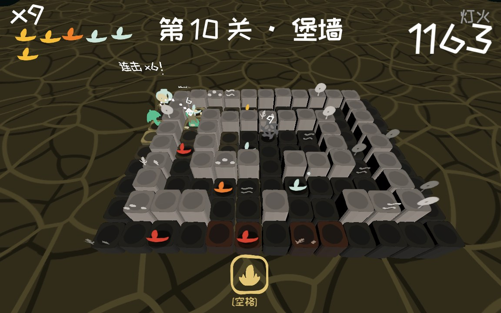

# 守望

江南水乡题材的回合制跳棋小品，Godot 4 工程。守塘的人夜里提灯出门，在河面上一格一格地跳，把河灯收齐，水车就开，走进去过关。




## 玩法

每局在一张浮在水面的棋盘上进行，河灯开局就摆好。从起点出发，沿着灯一盏一盏地收。

- 落在有灯的格子上不扣步数，连击 +1。连击越高，跳得越远。
- 踩到空格子扣一步，连击清零。主角头顶的数字是还能错几步。
- 收齐这一关的灯，水车就开。水车开了以后踩空格不再扣步，走进去过关。
- 有的沟只有靠道具才过得了，看准了再跳。
- 收灯给技能充能，充满了可以放一次技能。
- 一关没过可以原地再来，灯还是原来那一局（中等和简单下）。
- 玩法分四档难度，每上一档多几条规矩：手里的灯、步数带过关、风向、夜巡。见下面「难度四档」。

格子有四种：普通格；脆格，离开后碎掉，过一会儿长回来；障碍，落不上去；补给格，踩上去不扣步数反而加两步，每格每关只能用一次。

每关摆好的这一局是生成出来的，生成的时候就保证有一条一步不错就能收齐的路线。能不能过看会不会找路，不看运气。

### 道具

每关路线上摆着几件道具，跳上去捡。九种道具各管一件事：

| 道具 | 图标 | 捡到之后 |
|---|---|---|
| 莲蓬 | `combooo-1.png` 到 `combooo-6.png` | 连击 +3 |
| 纸伞 | `upgrade-umbrella.png` | 下一跳跳得特别远 |
| 草鞋 | `upgrade-shoe.png` | 这一关每一跳都更远 |
| 斗笠 | `hat.png` | 挡一次踩空（不扣步，连击也不断） |
| 钓竿 | `upgrade-cane.png` | 收走最远的两盏灯 |
| 捞网 | `upgrade-magnet.png` | 河灯都向你挪两格 |
| 水车 | `portal.png` | 卷走身边两格内的灯 |
| 食盒 | `chest.png` | 步数 +3 |
| 铜钱 | `clover.png` | 身边买来两件道具 |

图标都在 `assets/sprites/upgrades/`。另有蒸笼（`heart.png`，步数 +1），只在步数没带满进关的档（困难、非常困难）里出现。

### 两种模式

巡夜是主线，12 关，三章各四关，每章一种主色：水乡生活是石绿，家族传承是赭石，节庆巡游是朱砂。第一章学会连击跳，第二章开始有道具和沟，第三章棋盘大、路线长。巡夜里每一关是固定的一局，练的就是它。

长夜是无尽模式，棋盘和灯每次现摆，越往后越大、路线越长。步数从上一更带过去，每更补一步。

### 六位角色

| 角色 | 技能 | 怎么解锁 |
|---|---|---|
| 守夜人 | 点灯，两盏新的河灯落在身边 | 一开始就有 |
| 钓叟 | 甩竿，收走最远的两盏河灯 | 打到第 5 关 |
| 船家少年 | 一篙撑到底，这一步想跳多远都行 | 连击到 10 |
| 渔娘 | 撒网，把河灯都揽过来 | 一步未错地过一关 |
| 货郎 | 打开货担，身边落下一件道具 | 得分到 1000 |
| 小鼓手 | 敲一阵鼓，变出一枚莲蓬 | 一步未错、连击到 10 地过一关 |

小鼓手的连击上限更高，鼓点密了步子反而短。

## 难度四档

选了的记在存档里。三个地方都能换，玩到一半想换不用退回标题页：

- **标题页**：「难度 · 中等」按钮，点开是选择页，每一档多了什么规矩都写在上面。
- **玩到一半**：暂停菜单（Esc）第二行「难度 ‹ 中等 ›」，点一下箭头换一档。这一关马上按新难度从头来，前面几关的进度不丢。
- **没过的时侯**：结算面板上有一行「‹ 困难 ›」。点 ‹ 调低一档，马上重来这一关；点 › 调高一档。

半路调过难度的那一局，成绩记在用过的最低一档名下。

难度不是把数一个一个收紧，而是**每上一档多几条规矩**。每条规矩是一个开关，后面跟着它自己的数，全在 `resources/rulesets/` 下的 `.tres` 里：想调，改数就行，不用动代码。

| 难度 | 比上一档多了什么 | 适合 |
|---|---|---|
| 简单 | 步数宽三步，每一跳多跳 0.7 格，补给格多两个，手里有四盏灯 | 只想看画面 |
| 中等（默认） | 步数刚够，手里有两盏灯 | 大多数人 |
| 困难 | 步数少一步、从第一关带到最后一关（每关补一步，最多补到上限）；每关最多重来 3 次；有风向；沟多一道；手里只剩一盏灯 | 熟手 |
| 非常困难 | 不能重来；水车开了以后走回去还要花步数；夜巡；补给格少一个、道具少一件；手里没有灯 | 一步都不能错 |

几条规矩：

- **跳得远**（简单）：每一跳多跳 0.7 格。连击 2 就跳得过一道两格宽的墙，随手玩也不容易被困在半边棋盘上。
- **手里的灯**（简单、中等、困难）：开局手里有几盏自己的灯（简单四盏、中等两盏、困难一盏）。鼠标（手柄是光标）指着够得着的空格，按 E（手柄 X）放一盏，花一步。放上去的灯踩到算有灯、算收了一盏，可不给分、不加连击。踩了空、接不上的时候用它补一步。
- **步数带过关**（困难、非常困难）：过关以后步数不清零，带着走，每过一关补一步。步数没带满进关时棋盘上多一个蒸笼。
- **风向**（困难、非常困难）：每一关有风，左上角的旗子飘向哪边，风就往哪边吹。顺风跳得远、逆风跳得近（逆风再少也还能跳一格）。巡夜里每一关刮什么风是定的，连着两关不刮同一种风。
- **夜巡**（非常困难）：左上角有一支蜡烛在烧。蜡烧完，离你最远的那盏河灯就灭，灯少了就收不齐，这一关就守不住了。每跳一下蜡长回一点。一支蜡 30 秒，也是开头看棋盘的时间；之后每一步想得比 3 秒久，蜡就净短一截。
- **重来**：简单、中等没过可以原地再来（灯还是那一局）；困难每关最多 3 次；非常困难一关没过从头来。
- **水车开了走回去**：简单到困难，水车开了以后踩空格不扣步；非常困难要花步数，最后一盏灯得留着从水车边上收。

选择页上列的是当前这一档的规矩，都是读 `.tres` 自动生成的。玩法卡片和开局的那几条提示也跟着档变。

### 自己调

四个文件 `resources/rulesets/1_easy.tres` 到 `4_extreme.tres`，在 Godot 的检查器里打开，每条规矩一个分组。所有能调的数都在 `scripts/ruleset.gd` 里，带说明。常用的几个：

| 想改什么 | 改哪个数 |
|---|---|
| 步数宽紧 | `moves_add`；带过关的档还有 `moves_bonus`（每关补几步）、`moves_cap_add`（最多比上限多几步） |
| 跳得多远 | `reach_add`（每一跳多跳几格）。想让一档好过，加它，别减道具：道具和沟少了，长夜的随机棋盘反而容易摆不出保证有解的局 |
| 难不难找路 | `lamp_gate_add`（带沟的道具加减几件）、`lamp_items_add`（道具加减几件）。这两个对难易最管用 |
| 手里的灯 | `hold_lamps`（几盏）、`hold_cost`（放一盏花几步）、`hold_per_coin`（捡到铜钱多几盏） |
| 风 | `wind_bonus`（顺风多跳多远）、`wind_penalty`（逆风少跳多远）、`wind_floor`（逆风最少还能跳多远） |
| 夜巡的松紧 | `night_seconds`（一支蜡烧多久，也是开头看棋盘的时间）、`night_gain`（每跳一下长回几秒）、`night_every` |
| 补给格 | `spring_add` |

想再加一档：复制一份 `.tres`、改 `id` 和 `title`，文件名开头的数字是它在选择页里排第几。档数不限，测试里核对"由易到难"的地方按 `tier` 来。

### 过关率是量出来的

每一档的数不是拍脑袋定的。让"随手玩"的机器人（`BoardSim`：够得着的灯里挑最近的，不会找路）把每一档从头打 N 局，看它的过关率。它和游戏里摆棋、走棋用的是同一套代码（`BoardGen.ruleset_opt`、`BoardSim`），所以量和玩是同一种局。这是下限，真人多想一步就比它强。

```bash
tools/playtest/agent.sh a7 rates 200                 # 四档各打 200 局，报每一关的过关率、整局打通的比例
tools/playtest/agent.sh a7 rates 200 > builds/rates.txt && python3 tools/playtest/rates_report.py builds/rates.txt
                                                     # 量完把表换进 tools/playtest/rates.md（手写的说明不动）
tools/playtest/agent.sh a7 rates 100 3 hard          # 只打困难，设机器人每走一步想 3 秒（只对夜巡有用）
tools/playtest/agent.sh a7 rates 100 1 easy 'set=moves_add=3 set=hold_lamps=5'   # 临时改几个数再量，不写进 .tres
```

现在这一版的数见 `tools/playtest/rates.md`。`rates` 每回都核对，不对就报没过：四档由易到难（整局打通的比例一档比一档低）；简单档八成以上打穿；每一档长夜前 12 更"摆不出来"的局不超过 2%。

## 开场动画

游戏一启动播一段三四秒的开场，按任意键或手柄按键跳过。默认每次开机随机换一个，不会连着两次一样；「设置」里的「开场」可以固定成某一个，或者选「不播」。三个方案：

| 方案 | 是什么 |
|---|---|
| 一灯破夜 | 一片黑里一点灯花，一盏河灯漂上来，一串灯从水底涌起，汇到标志处炸开成光 |
| 水墨惊雷 | 宣纸上一滴墨化开，标志从墨里反白浮现，一方朱红大印盖下来，墨色铺满全屏转场 |
| 守夜人点灯 | 五块石台升起，守夜人一格一格跳过去，每落一格点亮一盏灯，最后一举灯照亮全屏 |

代码在 `scripts/uis/opening.gd`，着色器是 `shaders/opening_*.gdshader`，全是实时演的，没有视频文件。

每一段都配着一段声音，一下一下对着画面：灯花是火苗窜起来，涟漪是水珠落进水里，大印盖下来是一声堂鼓，守夜人每落一步是湿石台上的一声。开场播着的时候，标题页自己的音乐压低 13 分贝；揭出标题时音乐回来。开场自己的声音按音效的音量走。

乐器是古筝和琵琶，音都从标题音乐的调里来：升 C 宫五声（升 C、E、升 F、升 G、B）。三段各用一种招牌技法，一听就分得出：

| 方案 | 技法 | 画面上是什么 |
|---|---|---|
| A 一灯破夜 | 古筝**刮奏**（手指扫过一串弦，音一路往上） | 一串河灯从水底涌起来，正好是刮奏在往上走 |
| B 水墨惊雷 | 琵琶**扫弦**、古筝**按音**、印章用**堂鼓** | 墨落在纸上、大印盖下去；标志从墨里浮出来是古筝把弦按上去、音往上滑 |
| D 守夜人点灯 | 古筝**五声一步一个音往上走**，最后**摇指** | 守夜人一格一格跳过去，每落一步是一个音；举灯那一下摇指 |

三段是一套的：

- 底都是夜里的河面；水、木头、石头、纸、火这几样只是拟音，不是乐器；三段共用同一个混响空间。
- 最后都落在升 C 上，紧接着标题音乐从它的第一个和弦进来。
- 噪声类的拟音基本保持干声，像贴着录的；空间感留给弦乐。

录一段真正的开机画面来看（帧取回到 `builds/opening/<方案>/`）。录制脚本会核对游戏实际播的是不是要录的那个、声音放出来没有，不对就报错：

```bash
tools/playtest/agent.sh a7 opening B 5 20   # 录 5 秒、每秒 20 张（30 也行；再高这台机器存不过来，
                                            # 存少了按名义帧率回放，画面会比声音快——录制脚本会报出来）
tools/playtest/assemble_opening.sh          # 本机要有 ffmpeg：每个方案拼成带声音的 open<A>.mp4 和没声音的 open<A>.gif，
                                            # 三个都有的时候再拼三宫格的对照图 openALL（没声音）和三段连着放的 openABD.mp4（带声音）
```

查开场在游戏里的样子（在播、声音放出来了、音乐压低了；播完了音乐回来）：

```bash
SW_BOOT_WAIT=1 SW_OPENING=D tools/playtest/agent.sh a7 drive tools/playtest/steps_opening.txt opening
```

`SW_BOOT_WAIT=1` 是让脚本游戏一起来就动手（平时先等 6 秒，开场早播完了）；`SW_OPENING` 指定播哪一个，不给就按设置里的来。导出以后把 `drive` 换成 `smoke` 查导出包。

### 改声音

开场的声音不是录的，是用脚本算出来的，和贴图一个做法，每次算出来一模一样。改了动画里动作的时刻（`opening.gd`），声音要跟着改：

```bash
python3 tools/audio/opening.py            # 重算三段，写 assets/audio/opening/open<A>.wav，报每段的响度
python3 tools/audio/opening.py B --check  # 只算 B，另外在 builds/audio/ 里画一张频谱和波形图
python3 tools/audio/look.py 某段音频.wav   # 把任何一段声音画成图看
```

只用 numpy。三个文件各管一件事：

| 文件 | 放的是什么 |
|---|---|
| `tools/audio/synth.py` | 工具：噪声、包络、滤波、混响、写 WAV |
| `tools/audio/instruments_cn.py` | 古筝、琵琶，以及刮奏、摇指、轮指、扫弦、按音、推拉弦这些技法 |
| `tools/audio/instruments.py` | 拟音：水珠、水花、木块、石台脚步、水车吱呀、纸笔、灯火、闷雷、夜里的河面 |
| `tools/audio/opening.py` | 什么东西在哪一刻响、在哪边、多响。每一段对着动画的时间点，写在函数里 |

古筝和琵琶是照着弦振动的道理算的，不是采样；印章那一声是堂鼓（皮膜振动不成整倍数，打下去音高先高后落）：一根弦响的是它的整倍数泛音（真实弦越高的泛音偏得越多），拨在弦长的哪个位置决定哪些泛音响，越高的泛音灭得越快；木头琴身又有几个固定共鸣。两样乐器在这些地方不一样，所以听起来也不一样：

这些脚本我自己听不见，是看着频谱图和响度数字调出来的。哪一下不对，改了重算就行。

| 差别 | 古筝 | 琵琶 |
|---|---|---|
| 弦 | 丝缠钢丝弦，二十一根 | 四根，品上按 |
| 起手 | 软一点，指甲碰弦 | 义甲碰弦，一下很硬的亮声 |
| 余音 | 长，会唱（吟揉是音高的细颤） | 短，更脆 |
| 技法 | 刮奏、摇指、按音 | 轮指、扫弦、推拉弦 |

### 旁白（可选）

三句台词在 `tools/audio/voice.py` 的开头，是一套的。旁白得是人的声音，不由脚本生成：要么自己录，要么请人录。

```bash
tools/audio/record_voice.sh A       # 在本机录 A 那一句（要用麦克风），存到 builds/voice/
python3 tools/audio/voice.py A      # 收拾干净（去底噪、掐空白、对响度），放进 assets/audio/opening/voiceA.wav
```

放进去以后不用改任何东西：开场播到第 0.3 秒时这句放出来，开场自己的声音轻一截，说完回来。没有这个文件就不放。

## 背景：一条夜里的河

标题页和游戏里是同一条河，全是实时算的，没有背景图：暗底、几道细细的水纹（弯弯曲曲、断断续续，从远处往近处流）、暖色的河灯。河灯用的是 `assets/sprites/upgrades/fish.png` 那张涂鸦（开场「一灯破夜」里飞进标志的也是它），底下一团暖光、一道倒影，火苗会晃。

### 标题页

`scripts/uis/lobby_river.gd`，水面在 `shaders/lobby_river.gdshader` 里算。右上角是水里的月影，底下一道月光，水纹走进月光里会亮起来。

| 动一下 | 河面的反应 |
|---|---|
| 鼠标、手指划过水面 | 划过的地方起涟漪，附近的水纹亮一点，像提着灯照着 |
| 菜单的焦点挪到哪个按钮 | 那个按钮底下荡开一圈；点一下是一圈大的 |
| 开场动画收完 | 从标志底下荡开一圈，像那盏灯刚落回河里 |
| 一直没人动 | 河上的灯每 8 秒多一盏，最多 14 盏；一动就回到 6 盏上下 |

河灯漂到标志和菜单后面会让开（看不见），过去了再亮回来。

### 游戏里：三种布局（候选，还没定用哪种）

`scripts/stage_backdrop.gd` 挂在 `scenes/main.tscn` 里、界面那一层的前面，只读游戏里的水面、主角、棋盘和镜头，玩法不依赖它。水面是 `shaders/stage_water.gdshader`：真三维的水面，水纹画在世界上，远近的透视自己对。远岸的天空是 `shaders/stage_sky.gdshader`。三种布局共用这一套，只是光从哪来、装饰放在哪不一样：

| 布局 | 画面 |
|---|---|
| 1 长河 | 整个画面都是水；月影钉在左侧的空处，月光贴着那一侧往近处流 |
| 2 远岸 | 水到远处就到头了，顶上让出一条天空：一轮月亮、三层远山、山脚下的雾 |
| 3 月下 | 棋盘底下一汪月光；水纹在那一汪里让开，边上才亮 |

主角落到哪个格子，哪个格子底下就荡开一圈：水面上那一圈（落在棋盘中间时会被四周的格子挡住），加上格子面上的一圈淡环（画在最上层，站在哪儿都看得见）。

河的底色还是跟着章节和连击走：`colors.gd` 每一帧按 `water_color`、`light_foam_color`、`dark_foam_color` 这三个参数改它，参数名没换；只是往墨色里压了一截，是夜里的河。

**现在默认还是原来那块铺满网纹的水。** 三种布局是候选，定了哪种再换成默认。先用环境变量 `SW_STAGE` 切换着看：

```bash
SW_STAGE=2 tools/playtest/agent.sh a7 drive tools/playtest/steps_stage.txt 远岸   # 进第 1、8、12 关各截一张，再量帧时间
tools/playtest/agent.sh a7 stage 2                                               # 录一段进游戏、在棋盘上跳几下的
tools/playtest/assemble_stage.sh 2                                               # 拼成 builds/stage/stage2.mp4
tools/playtest/assemble_stage_all.sh                                             # 三种都录过以后，拼一段三个并排的
```

标题页那条河：

```bash
tools/playtest/agent.sh a7 lobby                                                     # 录 20 秒：没人动 → 指针划过 → 挪菜单焦点
tools/playtest/assemble_lobby.sh                                                     # 拼成 builds/lobby/lobby.mp4，带标题音乐
SW_OPENING=off tools/playtest/agent.sh a7 drive tools/playtest/steps_lobby.txt lobby   # 截图、量帧时间
```

`SW_OPENING=off` 是临时当成设置里选了「不播」。这时开机的黑幕要撤掉、标题页看得见，用 `steps_no_opening.txt` 查（以前只有开场动画才撤这块黑幕，选「不播」的话整个画面是黑的）。

河灯这一份两边共用：`scripts/uis/river_lamps.gd`。

## 操作

| | 键盘鼠标 | 手柄 |
|---|---|---|
| 跳 | W A S D，或者点亮着的格子 | 左摇杆、十字键 |
| 技能（菜单里是确认） | 空格 | A |
| 菜单 | Esc | Start、Back |
| 放一盏手里的灯（指着格子） | E | X |
| 返回 | | B |

手柄的左摇杆同时带着屏幕上的一个光标，停在按钮上时按 A 等于鼠标点击。

## 跑起来

要用 Godot 4.7.2，导出模板也是这个版本。用编辑器打开 `project.godot`，按 F5。

存档在用户数据目录下的 `Godot/app_userdata/守望/` 里：解锁的角色、本机成绩（每个模式、每一档难度、每个角色各一条）、看没看过哪条新手教程、选的难度和开场动画、开场上一次播的是哪个。

游戏启动时会在本机 `127.0.0.1:9878` 开一个调试端口，自动测试靠它驱动游戏。它只监听本机。本机成绩也只存在本机，不往任何服务器发。

## 目录

| 位置 | 放的是什么 |
|---|---|
| `scenes/` `scripts/` `resources/` | 场景、GDScript、关卡和角色道具的资源 |
| `scripts/board_gen.gd` | 摆一局河灯（保证有解）和给长夜生成棋盘，纯逻辑 |
| `scripts/board_sim.gd` | 一个"随手玩"的机器人，调难度和自动试玩都用它 |
| `scripts/ruleset.gd`、`resources/rulesets/` | 难度四档：每条规矩一个开关、带着它自己的数 |
| `scripts/uis/rule_hud.gd`、`assets/sprites/ui/rules/` | 游戏里左上角的旗子（风向）和蜡烛（夜巡）；加减器的箭头 |
| `scripts/uis/difficulty_stepper.gd` | 难度加减器「难度 ‹ 中等 ›」：暂停菜单里一行、没过的结算面板上一行 |
| `scripts/uis/opening.gd`、`shaders/opening_*.gdshader` | 开场动画 |
| `scripts/uis/lobby_river.gd`、`river_lamps.gd`、`shaders/lobby_*.gdshader` | 标题页的背景：那条河和河上的灯 |
| `scripts/stage_backdrop.gd`、`shaders/stage_*.gdshader` | 游戏里的背景：三种布局 |
| `scripts/autoload/pad_adapter.gd` | 手柄适配、调试遥控、自动试玩的机器人、录屏 |
| `shaders/` `materials/` | 抖动和染色 |
| `assets/sprites/` | 贴图。都是纯白剪影，颜色在运行时乘上去 |
| `assets/audio/` | 音乐和音效 |
| `tools/gen_campaign.py` | 巡夜 12 关的棋盘 |
| `tools/art/` | 画贴图的脚本，每张图都能从脚本重新画出来 |
| `tools/audio/` | 算开场声音的脚本，每一段都能从脚本重新算出来 |
| `assets/audio/opening/` | 开场动画的声音（算出来的）；`voice<A>.wav` 在的话是真人录的旁白 |
| `tools/test_boards.gd`、`tools/tune_deals.gd` | 棋盘逻辑和摆棋的自动测试；难度扫描 |
| `tools/tier_rates.gd` | 难度四档的过关率：机器人每一档打多少局 |
| `tools/playtest/` | 在服务器上自动试玩、导出、装到掌机 |
| `tools/handheld/` | 掌机上的启动脚本、菜单项、图标 |

## 改关卡

巡夜的棋盘只在一个地方定义：`tools/gen_campaign.py`。棋盘用字符画写，一行一个字符串：

```
.   普通格          空格   水，没有格子
S   起点            P      水车所在的格子（终点）
c   脆格            x      障碍
s   补给格
```

一张棋盘只能有一个起点和一个水车。改完运行 `python3 tools/gen_campaign.py .`，它会先校验所有棋盘，再写出 `resources/campaign/*.tres`。

每关收几盏灯、摆几件道具、难易，在 `scripts/board_gen.gd` 的 `CAMPAIGN_TABLE` 里，一行一关。长夜的难度曲线在同一个文件的 `endless_opt()` 里。

### 调难度

难易是量出来的，不是拍脑袋定的。每关的数字下面，让"随手玩"的机器人（`BoardSim`，够得着的灯里挑最近的）打 200 局，看它的过关率。这是下限，真人多想一步就比它强。这一段说的是中等这一档（摆法没有被难度的规矩改过）；四档各自的过关率见上面「难度四档」。

```bash
tools/playtest/agent.sh a7 boards             # 每关摆固定的一局并校验，再报机器人每关的过关率
```

现在的曲线（机器人过关率）：巡夜 100、100、97、100、67、70、76、59、58、44、32、24；长夜 100、90、82、68、50、50、35。

要大范围地扫参数，用 `tools/tune_deals.gd`（在服务器上跑，用法见文件开头）。

## 改美术

贴图不是手修的 PNG。每个元素在 `tools/art/` 里有一个画图脚本。改完跑：

```bash
tools/art/regen_all.sh                                                  # 重画全部，逐个脚本自检
python3 tools/art/review.py check . assets/sprites/ui/lock.png --zoom=0.32   # 单独自检一张
```

只需要 Python、Pillow 和 numpy，不跑 Godot。每张图的画布大小、图形范围、对称程度这些数，量好了存在 `tools/art/originals.json` 里，脚本靠它们让重画的图摆在原来的位置、大小相称。画法的几条规矩写在 `tools/art/doodle.py` 的开头，动手前先读一遍。

自检只查得出静态的问题。细节够不够清楚，要进游戏连拍着色器抖动的 10 个相位来看，用下面 `agent.sh` 的 `drive` 命令。

## 在服务器上测试和导出

本机不编译，试玩和导出都放到服务器上做。入口是 `tools/playtest/agent.sh <标签> <命令>`，在工程根目录下运行：

| 命令 | 做什么 |
|---|---|
| `base setup` | 建底版（带音频）。第一次用先跑一次 |
| `a7 setup`、`a7 sync`、`a7 import` | 建环境、同步工程、导入两遍；再不开窗口启动一回，自动加载的脚本和主场景都编译过了才算过 |
| `a7 boards` | 棋盘逻辑和摆棋的自动测试 |
| `a7 check` | 只检查脚本解析不解析得过，报出哪一行有错（写代码时先过这一道） |
| `a7 rates [局数] [每步想几秒] [档的id] ['set=名字=值 …']` | 难度四档的过关率（`tools/tier_rates.gd`）；最后的参数临时改数再量 |
| `a7 flow campaign`、`a7 flow endless` | 巡夜、长夜各走一遍过关流程 |
| `a7 aspect` | 巡夜 12 关各载入一遍，量棋盘是不是整个在画面里（默认 1152×720） |
| `a7 mechanics` | 长夜模式：补给格加步数、脆格碎掉后长回来、结算面板 |
| `a7 auto [campaign|endless] [1|2] [最多打到第几关] [前缀]` | 机器人真机玩一局。1 = 照着摆好的路线走（必须一步不错、关关都过）；2 = 贪心打法。顺手查棋盘上的登记：一盏灯不能登记在两个格子上 |
| `a7 drive <步骤文件> [前缀]` | 按步骤操作游戏并截图。步骤的写法见 `drive_v100.sh` 的开头。日志里有报错，或者某一步调的检查报了没过，退出码就不是 0 |
| `a7 opening [A|B|D] [秒数] [每秒几张]` | 录一段开场动画，核对播的是不是要录的那个、声音放出来没有 |
| `a7 lobby [秒数] [每秒几张]` | 录一段标题页的背景（那条河、河灯、划过水面和挪焦点时荡开的涟漪），帧取回到 `builds/lobby/rec/` |
| `a7 stage <1\|2\|3> [秒数] [每秒几张]` | 录一段游戏里的背景：进游戏、在棋盘上跳几下，帧取回到 `builds/stage/<布局>/` |
| `a7 all` | 一轮完整回归（它不同步工程，先 `sync`）：`import` → `boards` → 两种过关流程 → `aspect` → `mechanics` → `auto campaign 1` → 四档的规矩自检 → 换难度 → 存档隔离 → 河灯的层级，哪一步没过就停在那一步 |
| `a7 export`、`a7 fetch` | 导出 Linux 可执行文件（日志里有报错就不出包）；取回到 `builds/linux/shouwang.x86_64` |
| `a7 smoke <步骤文件>` | 试跑导出来的可执行文件。`steps_export.txt` 是导出包自检：四档难度、道具、旗子和蜡烛这些按路径读的资源在包里都读得到 |
| `a7 clean` | 删掉服务器上这个标签的目录 |

每个标签在服务器上有一套独立的目录、端口和虚拟显示，几个任务可以同时跑。截图取回到 `builds/shots/<标签>/`。

换一档难度来测：`SW_RULESET=hard tools/playtest/agent.sh a7 auto campaign 2`。四档的 id 是 `easy`、`normal`、`hard`、`extreme`。这样指定不写存档。

四档的规矩在游戏里的样子（旗子、蜡烛、放灯、灯灭、重来按钮），每一档各跑一遍：

```bash
for t in easy normal hard extreme; do SW_RULESET=$t tools/playtest/agent.sh a7 drive tools/playtest/steps_rules.txt rules_$t; done
```

玩到一半换难度（暂停菜单里的加减器、结算面板上的加减器，连版面一起查；版面在 16:9 的窗口里也查一遍，带上 `SW_RES=1280x720`）：

```bash
tools/playtest/agent.sh a7 drive tools/playtest/steps_difficulty.txt diff
SW_RES=1280x720 tools/playtest/agent.sh a7 drive tools/playtest/steps_difficulty.txt diff_1280
```

标题页那条河上的灯要画在界面底下。河灯为了分远近各自带着 `z_index`，而 `z_index` 是整个画面层里一起排的，所以整条河在 `lobby_river.gd` 里压到了界面下面；否则灯会漂到难度页、设置页的上头，把字盖住。下面这条在河上凑满 14 盏灯的时候开着难度页、设置页各量一遍（每盏灯的 `z_index` 都比界面的小）：

```bash
SW_OPENING=off SW_BOOT_WAIT=2 tools/playtest/agent.sh a7 drive tools/playtest/steps_river_layers.txt riverlayers
```

机器人平时每走一步只等 0.4 秒，夜巡对它不起作用。想知道"一个真人每步想几秒"能不能过，让它按那个节奏走：

```bash
SW_RULESET=extreme SW_AUTO_PACE=5 tools/playtest/agent.sh a7 auto campaign 2    # 每步想 5 秒
```

机器人每一关都等灯摆完了才动手，换关后多久动的手会打进游戏日志。查它为什么跳不到，或者试它在灯没摆完的时候会不会乱动：

```bash
SW_AUTO_TRACE=1 tools/playtest/agent.sh a7 auto campaign 1    # 它每一步都打进日志
SW_AUTO_EAGER=1 tools/playtest/agent.sh a7 auto campaign 1    # 换关后只等 0.2 秒就动手（平时 1.5 秒）
```

测试用的存档是服务器上各个测试共用的，选过的难度会留在里面；要按默认的「中等」测，带上 `SW_RULESET=normal`。
用环境变量临时指定的难度和开场不写进这份存档（局里别的保存动作也不会把它带进去；`steps_save.txt` 查的就是这个，`all` 里带着跑）：

## 装到掌机

```bash
tools/playtest/agent.sh a7 export
tools/playtest/deploy_handheld.sh
```

掌机用 `~/.ssh/config` 里的别名 `RWKV_Tail` 连，地址、用户名、钥匙都写在那里。部署只换文件，不启动游戏，也不打断正在跑的那一局。旧的包留作 `shouwang.x86_64.prev`。

想在掌机上试跑一遍，用 `tools/playtest/verify_handheld.sh`。它会占住掌机的屏幕，并关掉正在跑的游戏，所以只在确认没人在玩的时候用，并且要带上参数 `yes`。
